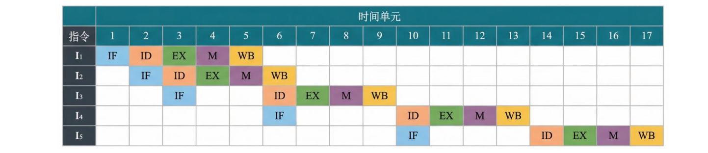

# 2012-44：补码运算与指令流水线执行分析

## 一、题目条件

某16位计算机中，带符号整数采用补码表示，数据Cache和指令Cache分离。

| 指令 | 汇编格式 | 指令功能 |
|---|---|---|
| 加法指令 | `ADD Rs,Rd` | (Rs)+(Rd) → Rd |
| 算术左移 | `SHL Rd` | (Rd)×2 → Rd |
| 算术右移 | `SHR Rd` | (Rd)/2 → Rd |
| 取数指令 | `LOAD Rd,mem` | (mem) → Rd |
| 存数指令 | `STORE Rs,mem` | (Rs) → mem |

处理器采用5段流水线：

| 阶段 | 名称 | 功能 |
|---|---|---|
| IF | 取指 | 从指令Cache取指令 |
| ID | 译码 | 译码、读取寄存器 |
| EX | 执行 | 运算、计算有效地址 |
| M | 访存 | 访问数据Cache |
| WB | 写回 | 将结果写回寄存器 |

**题目特别条件：**

1. 采用按序发射、按序完成。
2. 不采用转发技术处理数据相关。
3. 同一个寄存器的读和写操作不能在同一个时钟周期内进行。
4. 指令Cache和数据Cache分离。

**重要规则：**

- ID阶段读取寄存器。
- WB阶段写回寄存器。
- 如果前一条指令在第5周期WB写回R1，后一条指令最早在第6周期ID读取R1。

---

## 二、第（1）问：算术右移与补码

**题目：**

若int型变量x的值为-513，存放在寄存器R1中，执行指令：

```asm
SHR R1
```

求执行后R1的内容，用十六进制表示。

### 1. 将-513转换为16位补码

首先将513转换为十六进制：

513 = 0201H

计算-513的补码：

补码 = 2^16 - 513

= 65536 - 513

= 65023

转换为十六进制：

65023 = FDFFH

所以：

R1 = FDFFH

### 2. 执行算术右移

原来的二进制：

```text
1111 1101 1111 1111
```

算术右移1位时，最高位用原来的符号位补充。

右移后：

```text
1111 1110 1111 1111
```

转换为十六进制：

FEFFH

**答案：**

R1 = FEFFH

### 3. 注意区分逻辑右移和算术右移

| 类型 | 右移时最高位补充 |
|---|---|
| 逻辑右移 | 补0 |
| 算术右移 | 补原来的符号位 |

负数进行算术右移时，需要保留符号位。

---

## 三、第（2）问：无阻塞流水线执行时间

**题目：**

若某个时间段中，有连续的4条指令进入流水线，在其执行过程中没有发生任何阻塞，求执行这4条指令所需的时钟周期数。

### 1. 已知条件

- 指令条数：4条
- 流水线段数：5段
- 没有发生阻塞。

### 2. 计算公式

无阻塞流水线执行n条指令所需的时钟周期：

T = n + k - 1

其中：

- n：指令条数；
- k：流水线段数。

代入：

T = 4 + 5 - 1 = 8

### 3. 流水线时序表

| 指令 | 第1周期 | 第2周期 | 第3周期 | 第4周期 | 第5周期 | 第6周期 | 第7周期 | 第8周期 |
|---|---|---|---|---|---|---|---|---|
| I1 | IF | ID | EX | M | WB | | | |
| I2 | | IF | ID | EX | M | WB | | |
| I3 | | | IF | ID | EX | M | WB | |
| I4 | | | | IF | ID | EX | M | WB |

第一条指令需要5个周期完成，后续每条指令只需要增加1个周期。

**答案：8个时钟周期。**

---

## 四、第（3）问：数据相关与流水线阻塞

**题目：**

高级语言程序中的赋值语句：

```c
x = a + b;
```

对应的指令序列：

```asm
I1: LOAD R1, [a]
I2: LOAD R2, [b]
I3: ADD R1, R2
I4: STORE R2, [x]
```

要求分析：

1. I3的ID段被阻塞的原因。
2. I4的IF段被阻塞的原因。

### 1. 理解每条指令的功能

根据题目给出的ADD指令格式：

ADD Rs,Rd

其功能为：

(Rs)+(Rd) → Rd

因此：

| 指令 | 功能 |
|---|---|
| I1 | 从内存[a]读取数据，写入R1 |
| I2 | 从内存[b]读取数据，写入R2 |
| I3 | R1+R2，结果写入R2 |
| I4 | 将R2的内容写入内存[x] |

### 2. 分析I1和I2的执行时间

没有发生阻塞时：

| 指令 | IF | ID | EX | M | WB |
|---|---|---|---|---|---|
| I1 | 1 | 2 | 3 | 4 | 5 |
| I2 | 2 | 3 | 4 | 5 | 6 |

因此：

- I1在第5个时钟周期将数据写入R1。
- I2在第6个时钟周期将数据写入R2。

### 3. 为什么I3的ID阶段被阻塞？

I3指令：

```asm
ADD R1, R2
```

需要在ID阶段读取R1和R2。

但是：

- 第5周期，I1正在WB阶段写入R1。
- 第6周期，I2正在WB阶段写入R2。

题目明确规定，同一个寄存器的读和写操作不能在同一个时钟周期内进行。

因此：

- 第5周期不能读取R1。
- 第6周期不能读取R2。
- 第7周期才能同时读取R1和R2。

所以I3的ID阶段必须等待到第7周期。

### 4. 为什么I4的IF阶段被阻塞？

I3的ID阶段被阻塞时，无法继续进入EX阶段。

由于流水线按序发射，后续指令不能越过前面的指令。

因此I4无法正常进入流水线，IF阶段也被阻塞。

当I3在第7周期进入ID阶段后，I4才能在第7周期进入IF阶段。

### 5. 为什么I4的ID阶段还要等待？

I4指令：

```asm
STORE R2, [x]
```

需要读取R2中的数据。

而I3执行：

```asm
ADD R1, R2
```

会将计算结果写回R2。

I3的执行过程：

| 阶段 | 周期 |
|---|---|
| IF | 3 |
| ID | 7 |
| EX | 8 |
| M | 9 |
| WB | 10 |

因此I3在第10周期才将计算结果写回R2。

由于不能在同一周期读写R2，所以I4最早只能在第11周期读取R2。

### 6. 完整流水线执行过程

| 指令 | IF | ID | EX | M | WB |
|---|---:|---:|---:|---:|---:|
| I1 | 1 | 2 | 3 | 4 | 5 |
| I2 | 2 | 3 | 4 | 5 | 6 |
| I3 | 3 | 7 | 8 | 9 | 10 |
| I4 | 7 | 11 | 12 | 13 | — |

**答案：**

- I3的ID阶段被阻塞：等待I1和I2分别将结果写回R1、R2。
- I4的IF阶段被阻塞：前面的I3发生阻塞，后续指令不能越过I3。
- I4的ID阶段被阻塞：等待I3将计算结果写回R2。

### 7. 本问的核心理解

RAW（Read After Write）：写后读相关。

即后面的指令需要读取前面指令写入的结果。

本题没有采用转发技术，因此必须等待前面的指令将结果写回寄存器，后面的指令才能读取。

---

## 五、第（4）问：指令序列与流水线执行时间

**题目：**

高级语言程序中的赋值语句：

```c
x = x * 2 + a;
```

其中x和a均为unsigned int类型变量，存储单元地址分别为[x]和[a]。

求执行这条语句至少需要多少个时钟周期，并画出流水线执行过程。

### 1. 将高级语言转换为汇编指令

原表达式：

x = x × 2 + a

根据题目提供的指令：

- LOAD：从主存读取数据到寄存器。
- SHL：将寄存器内容左移一位，相当于乘2。
- ADD：两个寄存器相加，结果写入目的寄存器。
- STORE：将寄存器内容写入主存。

可以构造如下指令序列：

```asm
I1: LOAD R1, [x]
I2: LOAD R2, [a]
I3: SHL R1
I4: ADD R2, R1
I5: STORE R1, [x]
```

逐条分析：

| 指令 | 功能 |
|---|---|
| I1 | R1 = x |
| I2 | R2 = a |
| I3 | R1 = R1 × 2 |
| I4 | R1 = R2 + R1 |
| I5 | x = R1 |

最终得到：

x = 2x + a

### 2. 分析第一处数据相关：I1与I3

```asm
I1: LOAD R1, [x]
I3: SHL R1
```

I1需要将x写入R1，I3需要读取R1。

I1的流水线：

| 阶段 | 周期 |
|---|---|
| IF | 1 |
| ID | 2 |
| EX | 3 |
| M | 4 |
| WB | 5 |

I1在第5周期写回R1。

由于同一周期不能同时读写R1，因此I3最早在第6周期进入ID阶段。

### 3. 分析第二处数据相关：I2、I3与I4

```asm
I2: LOAD R2, [a]
I3: SHL R1
I4: ADD R2, R1
```

I4需要读取R1和R2。

其中：

- I2在第6周期写回R2。
- I3在第9周期写回R1。

因此，I4必须等待两个寄存器都完成写回。

I4最早在第10周期进入ID阶段。

### 4. 分析第三处数据相关：I4与I5

```asm
I4: ADD R2, R1
I5: STORE R1, [x]
```

I4执行加法后，将结果写回R1。

I4的WB阶段在第13周期。

I5需要读取R1中的结果，因此最早只能在第14周期进入ID阶段。

注意：STORE指令在M阶段完成主存写入，不需要WB阶段写回寄存器。

### 5. 完整流水线时序表

| 指令 | IF | ID | EX | M | WB |
|---|---:|---:|---:|---:|---:|
| I1 LOAD | 1 | 2 | 3 | 4 | 5 |
| I2 LOAD | 2 | 3 | 4 | 5 | 6 |
| I3 SHL | 3 | 6 | 7 | 8 | 9 |
| I4 ADD | 6 | 10 | 11 | 12 | 13 |
| I5 STORE | 10 | 14 | 15 | 16 | — |

### 6. 计算总时钟周期

最后一条STORE指令在第16周期的M阶段完成主存写入。

因此：

**答案：16个时钟周期。如果算STORE的WB是17个周期**  

### 7. 为什么这样安排指令？

本题将两条LOAD指令安排在前面：

```asm
LOAD R1, [x]
LOAD R2, [a]
SHL R1
ADD R2, R1
STORE R1, [x]
```

这样可以利用读取a的过程，减少后续SHL指令的等待时间。

如果采用：

```asm
LOAD R1, [x]
SHL R1
LOAD R2, [a]
ADD R2, R1
STORE R1, [x]
```

那么SHL紧跟LOAD，必须等待LOAD将结果写回R1，容易产生更多流水线停顿。

因此，合理安排指令顺序，可以利用相互独立的指令填补等待时间，减少流水线阻塞。

---

## 六、最终答案汇总

| 小问 | 答案 |
|---|---|
| （1） | R1 = FEFFH |
| （2） | 8个时钟周期 |
| （3） | I3的ID阶段等待R1、R2写回；I4的IF阶段因前序阻塞而等待 |
| （4） | 16个时钟周期 |

---

## 七、流水线分析必记规则

1. **ID阶段：** 读取寄存器。
2. **EX阶段：** 执行运算、计算有效地址。
3. **M阶段：** 访问主存或数据Cache。
4. **WB阶段：** 将计算结果写回寄存器。
5. **无转发技术：** 后续指令必须等待前面指令将结果写回寄存器。
6. **同周期不能读写：** 如果前一条指令在第n周期WB写回，后一条指令最早在第n+1周期ID读取。
7. **按序发射：** 前面的指令阻塞，可能导致后续指令无法进入流水线。
8. **STORE指令：** 在M阶段完成主存写入，通常没有WB阶段。
